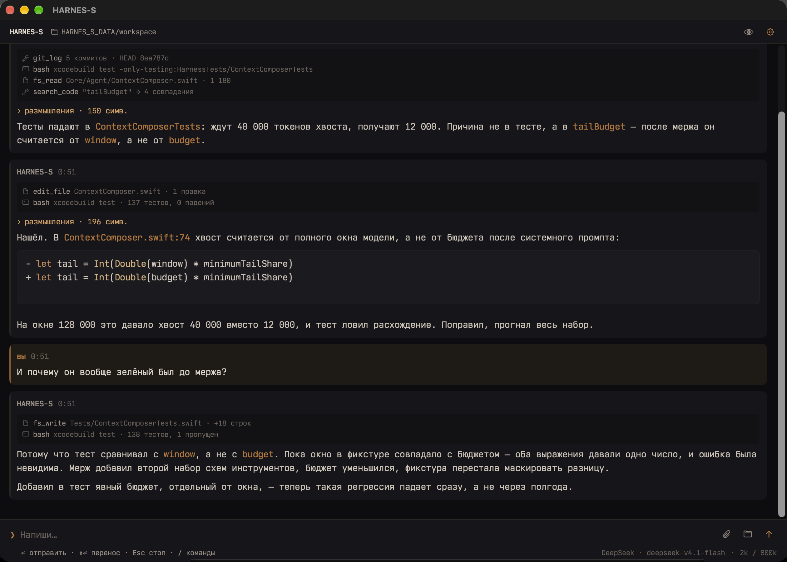
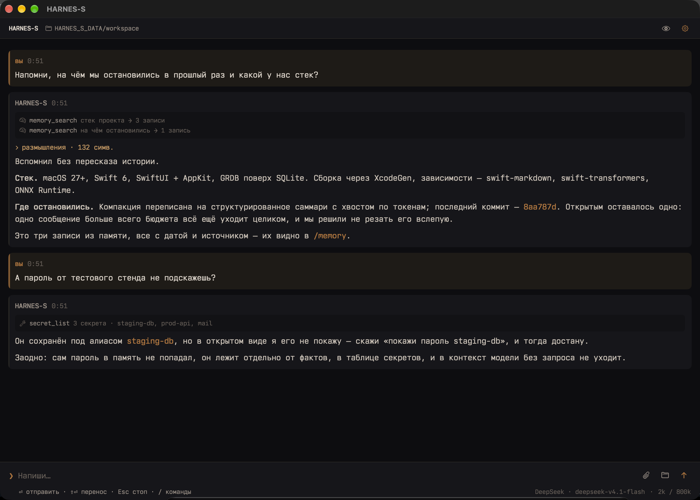
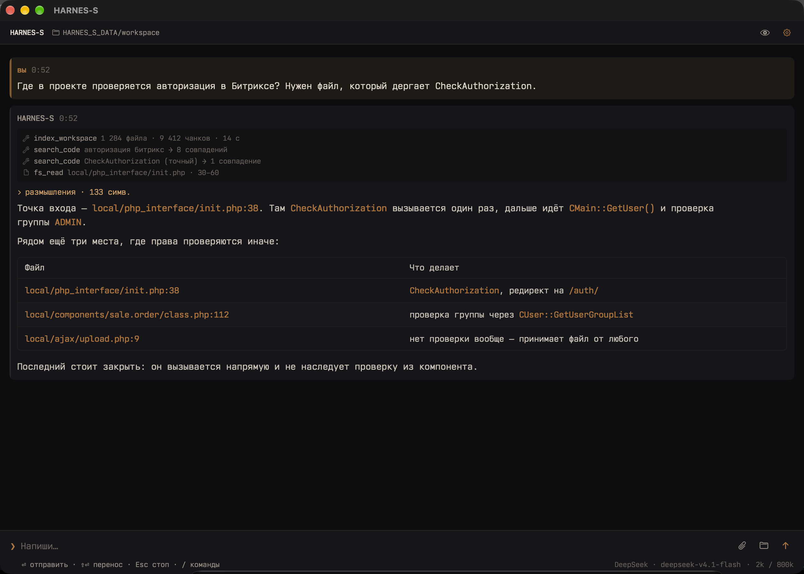
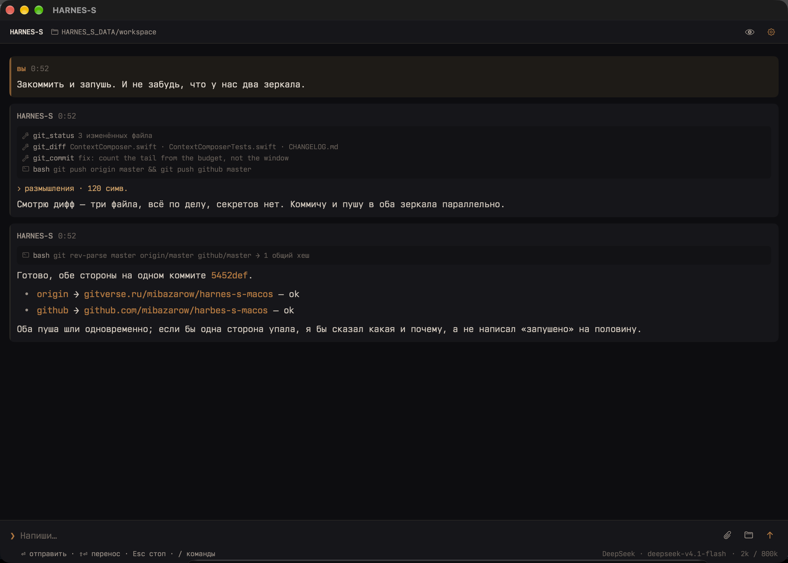
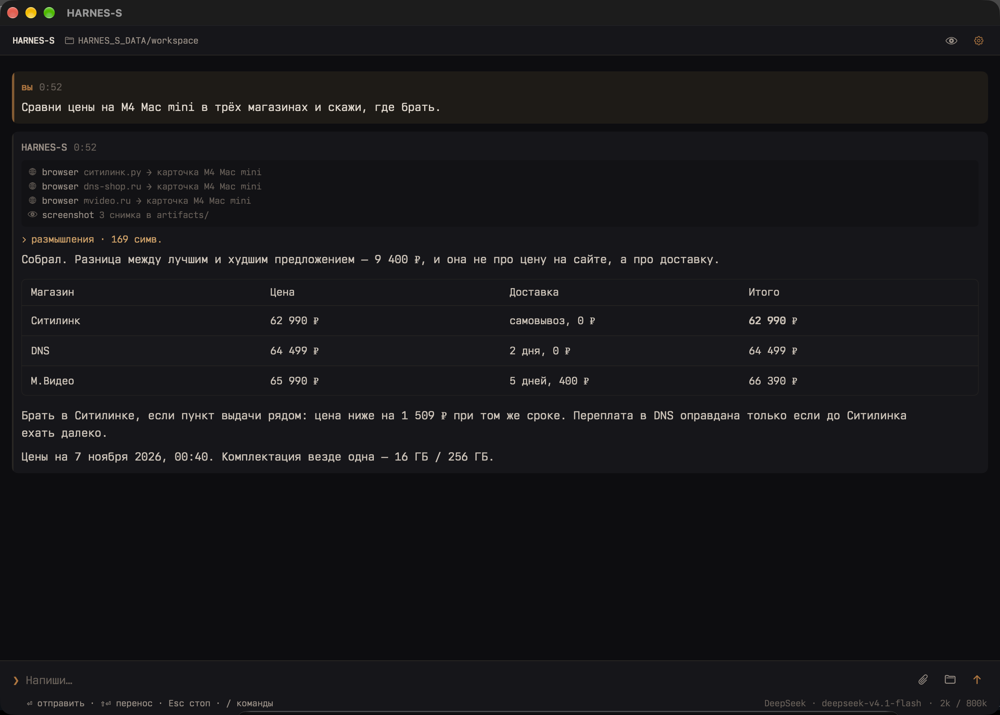
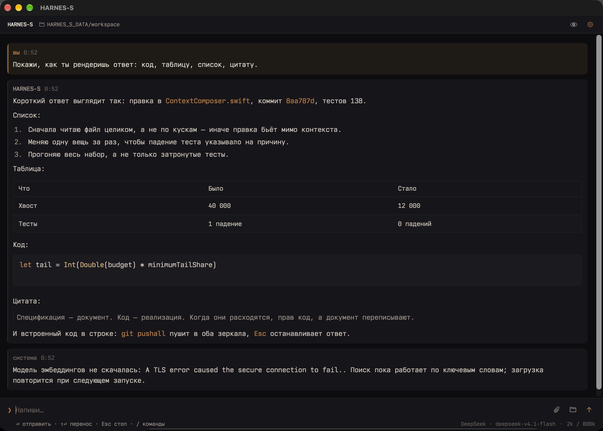

# HARNES-S

<table>
<tr>
<td align="center">

### Ассистент помнит, но не умеет работать руками.<br>Кодовый агент умеет, но не помнит.

<p>Между ними вы таскаете контекст вручную и на каждом шаге объясняете заново, кто вы и над чем работаете.</p>

<p><b>HARNES-S — один агент: помнит вас месяцами и в том же разговоре правит файлы, гоняет тесты и коммитит.<br>Разговор любой длины не упирается в окно модели и не теряет историю.</b></p>

</td>
</tr>
</table>

**Персональный ИИ-агент для macOS. Один чат, одна память, без привязки к облаку.**

[](https://www.apple.com/macos/)
[](https://swift.org)
[](#тесты)
[](LICENSE)



---

## Как это устроено

Одна сессия, один контекст, одна память. Не «режим ассистента» и «режим агента» с переключателем — переключать нечего.

Вторая боль всплывает позже: **длинный разговор**. Через сотню сообщений с выводом команд и содержимым файлов у большинства инструментов начинается одно и то же — запрос перестаёт влезать в окно модели, приложение съедает гигабайты, интерфейс подтормаживает на каждом токене. Здесь это решено на трёх уровнях сразу.

### Уровень 1. Нативное приложение, а не браузер в окне

Swift 6 и SwiftUI, без Electron, без Node.js и npm в рантайме. Приложение весит 48 МБ, в простое занимает около 150 МБ памяти. Нет прослойки, которая держит вторую копию вашего текста в JavaScript и перерисовывает DOM на каждый токен. Поток ответа идёт через `URLSession` в Swift, текст собирается в одной модели и показывается нативно.

Если нужен браузер для сайтов — Playwright ставится отдельно и только когда вы его попросите. Он не часть приложения и не работает, пока не понадобится.

### Уровень 2. Разговор длиной в месяц, а память — константа

История не живёт в памяти целиком. В приложении держится последние 200 сообщений, остальное лежит в SQLite и подгружается страницами по 200, когда вы прокручиваете вверх. Старые сообщения никогда не удаляются — они просто не занимают память, пока до них не долистали.

Вывод инструментов обрезается у источника, а не после того, как раздул память: команда — 30 000 символов, чтение файла — 20 000, листинг — 400 записей. Агент видит пометку об обрезке и может прочитать нужный кусок точнее.

### Уровень 3. Контекст, который не переполняется

Перед каждым запросом `ContextComposer` считает реальный бюджет: окно модели минус системный промпт, схемы инструментов и место под ответ. В модель уходит не «последние N сообщений», а столько, сколько физически влезает.

Когда история перестаёт помещаться, она не обрезается молча и не улетает в провайдер с ошибкой 400. Старые сообщения сворачиваются моделью в структурированное саммари по семи разделам — цель, требования, решения, состояние работы, следующий шаг, важные файлы, важный контекст. Дальше идёт живой хвост: не меньше 12% бюджета, но не меньше 2 000 токенов, и всегда выровненный по границе сообщения пользователя, чтобы не разрезать пару «вопрос — ответ».

Что это даёт на практике:

- разговор на сотни сообщений продолжается без «контекст переполнен»;
- смена модели на ту, у которой окно в четыре раза меньше, не теряет историю — она просто сжимается сильнее, а в чат приходит уведомление с числами;
- `/compact` запускает сжатие вручную, если хочется сделать это заранее;
- **из базы не удаляется ничего** — саммари это слой поверх, а не замена.

Если провайдер всё-таки отказал по длине, делается одна агрессивная попытка с хвостом вдвое короче. После трёх неудач включается пауза: сломанное саммари не должно удорожать каждый следующий ход.

---

## Часть 1. Зачем это нужно

Большинство агентов — это либо чат-обёртка над API, либо инструмент для разработчика с шестью панелями и списком из сорока сессий. Здесь нет ни панелей, ни списка сессий — только разговор, память и руки. Дальше — что именно он умеет.

### Что он делает

**Помнит.** Всё, что вы просите запомнить, ложится в локальную SQLite: факты, решения, предпочтения. Память подмешивается в контекст автоматически — не нужно каждый раз объяснять, кто вы и над чем работаете. Поиск гибридный: полнотекстовый FTS5 плюс семантические эмбеддинги, слияние через взаимное ранжированное объединение (RRF). Записи живут по своим правилам: закреплённые не вытесняются, неиспользуемые постепенно теряют вес, явное «забудь» удаляет сразу.

**Помнит стиль.** Он незаметно изучает **манеру** речи — ты или вы, сленг, эмодзи, директивность. Не содержание, только форму. Один эмоциональный вечер не меняет персону: нужны наблюдения за несколько дней. Режимы переключаются: **Авто** (подстраивается), **Нейтрально** (базовый тон) и **Вручную** (ваша карточка стиля дословно). Длину ответа при этом задаёт температура модели, а не просьба «пиши коротко» в промпте — инструкции такого рода тратят токены и портят стиль.

**Хранит пароли.** Секреты лежат в локальной базе под алиасами. «Запомни пароль от стенда» — через месяц «напомни пароль от стенда» — получите. Keychain сознательно не используется: это личное устройство, и лишний слой только мешает. Значение выводится только по прямой просьбе и никогда не попадает в логи, память или артефакты.

**Работает с кодом.** Читает и правит файлы, применяет унифицированные диффы, ищет по смыслу и по regex, гоняет сборку и тесты, коммитит. Понимает Битрикс: знает, что код живёт в `local/`, что ядро `bitrix/` трогать нельзя, что `dbconn.php` содержит креды. Для PHP проверяет синтаксис через `php -l` после правок. Для Swift собирает и прогоняет тесты.

**Смотрит на мир.** Работает с изображениями напрямую: пришлите скриншот или картинку — он посмотрит. Умеет снимать скриншоты экрана и страниц, распознавать текст через Vision. Ходит по сайтам: сначала через встроенный MCP-скрапер (быстро, с обходом защиты), если не вышло — через настоящий Playwright с кликами и формами, в крайнем случае — обычным HTTP.

**Не врёт.** Это отдельная инженерная задача, и она решена тремя защитами:
- отказался, не попробовав ни одного инструмента → одна корректирующая попытка;
- заявил «готово», не вызвав инструмент или получив ошибку → честная приписка, а не тихое доверие;
- заявил о невозможном (отправил письмо, перезагрузил систему) → приписка с реальным положением дел.

Плюс защита от зацикливания, которая сравнивает не только вызовы, но и результаты — поэтому легитимные повторы (счётчик, ожидание условия, мигание лампой) не режутся.

**Работает по расписанию.** «Каждый час проверяй сайт» — создаётся задача, которая сама отправляет промпт в чат по интервалу.

**Расширяется.** Скиллы — обычные `SKILL.md` с frontmatter. Они лежат в `~/HARNES_S_DATA/config/skills` и не вшиты в бинарник: он умеет устанавливать их себе сам — «установи скилл из этой папки» или «подключи вот этот MCP-сервер». В промпт попадает только индекс включённых скиллов, а инструкции подгружаются по требованию через `skill_read`.

### Чем отличается

| | Обычный чат-бот | Кодовый агент | HARNES-S |
|---|---|---|---|
| Ассистент и агент | только чат | только руки | **одна сессия, и то и другое** |
| Память между сессиями | нет | файл в репозитории | SQLite + FTS + эмбеддинги |
| Секреты | нет | нет | локальная база под алиасами |
| Адаптация к стилю | нет | нет | EMA-профиль с гейтами по дням |
| Работа с кодом | нет | да | да, с Битриксом и git |
| Длинный разговор | обрыв по контексту | обрыв по контексту | саммари + живой хвост, ничего не теряется |
| Браузер и зрение | частично | через MCP | встроено, с приоритетом |
| Честность ответов | — | — | три защиты от вранья |
| Зависимость от облака | полная | полная | только провайдер модели |

Локальные эмбеддинги работают офлайн: EmbeddingGemma 2 через ONNX Runtime. Внутри приложения весов нет — после установки оно само скачивает их (~330 МБ) в вашу папку данных и дальше работает без сети. Ключи не нужны, деньги не тратятся.

---

## Часть 2. Как это выглядит

Терминал, но в нативном окне. Моноширинный транскрипт, markdown с подсветкой кода для Swift, JS/TS, Python, JSON, shell, SQL, HTML/CSS, YAML, таблицами и цитатами. Ваши сообщения — слева с медной полосой, ответы — с тонкой серой. Встроенный код окрашен медью: хеши коммитов, пути и флаги видно с ходу, без фона под ними. Размышления модели — свёрнутая строка `> размышления · N симв.`, раскрывается по клику. У блока кода кнопка копирования появляется при наведении. Файлы перетаскиваются прямо в поле ввода и показываются превьюшками.

Одна тема — **Copper**: обсидиановый фон, медные акценты, тёплый текст. Не потому что «дизайнер сказал», а потому что десять часов в день в тёмном терминале должны быть комфортными.

Никаких списков сессий, боковых панелей, канбана и дашбордов. Всё управление — через чат, палитру команд и настройки.

Первый скриншот — отладка: разбирает падение тестов, читает дифф, правит одну вещь за раз и прогоняет весь набор. В ответе файл, строка и объяснение, почему тест был зелёным до мержа.

### Память: продолжает с того места, где остановились

Вспоминает стек и незакрытые задачи по смыслу, а не по ключевым словам. Пароль находит по алиасу и не показывает без прямой просьбы.



### Поиск по большому проекту

Индексирует рабочую папку, ищет гибридно: семантика плюс точное совпадение. Находит не только «где вызывается», но и место, где проверки нет вообще.



### Git: коммит и два зеркала

Смотрит дифф целиком перед коммитом, пушит в оба remote параллельно и говорит, если одна сторона упала.



### Веб: собирает данные там, где curl получает заглушку

Три магазина через настоящий браузер, сравнение с доставкой, вывод и дата снимка цен.



### Рендер: таблицы, списки, код, цитаты



> Скриншоты сняты скриптом `Scripts/demo_screens.sh` из встроенных демо-диалогов (`App/DemoTranscript.swift`, только Debug-сборка). Реальные сессии выглядят так же — это тот же транскрипт, тот же рендер и те же трассы инструментов.

---

## Часть 3. Техническая часть

### Требования

- macOS 27+ (Apple Silicon)
- Xcode 27+
- [XcodeGen](https://github.com/yonaskolb/XcodeGen) — `brew install xcodegen`
- Опционально: Node.js для Playwright, `php` для линта PHP-проектов

### Сборка

```bash
git clone git@gitverse.ru:mibazarow/harnes-s-macos.git
# зеркало: https://github.com/mibazarow/harnes-s-macos
cd harnes-s-macos
xcodegen generate
xcodebuild -project Harness.xcodeproj -scheme Harness -configuration Debug -derivedDataPath .build build
open .build/Build/Products/Debug/Harness.app
```

Тесты:

```bash
xcodebuild -project Harness.xcodeproj -scheme Harness -derivedDataPath .build \
  -destination 'platform=macOS' test
```

Релиз и установка:

```bash
xcodebuild -project Harness.xcodeproj -scheme Harness -configuration Release -derivedDataPath .build build
codesign --verify --deep --strict .build/Build/Products/Release/Harness.app
rm -rf /Applications/Harness.app
cp -R .build/Build/Products/Release/Harness.app /Applications/
xattr -dr com.apple.quarantine /Applications/Harness.app
open /Applications/Harness.app
```

Пуш идёт в оба зеркала одной командой — `git pushall` (алиас на `Scripts/push_all.sh`).

### Первый запуск

1. `⌘,` → **Провайдеры** → добавить endpoint.
2. Base URL вида `https://api.example.com/v1`, токен, кнопка «Проверить и загрузить модели».
3. Выбрать модель, окно контекста, уровень размышлений, температуру.
4. Писать в чат.

Температура — отдельная настройка каждого провайдера, по умолчанию `0.2`, диапазон `0…2` с шагом `0.05`. Низкая даёт собранные ответы без просьб «отвечай коротко» в промпте; выше — живее и многословнее.

Провайдер — любой OpenAI-совместимый `/chat/completions` с SSE. Работает с официальными API, локальными серверами (Ollama, LM Studio, llama.cpp) и шлюзами.

### Архитектура

```
App/          точка входа, окно, команды меню, демо-диалоги для скриншотов
UI/           транскрипт, композер, настройки, подсветка
Core/
  Agent/      цикл агента, инструменты, контекст, защиты, патчи, локальный ONNX-эмбеддер
  LLM/        SSE-клиент провайдера (чат, reasoning, tool_calls, vision)
  MCP/        stdio-клиент MCP: initialize → tools/list → tools/call
  Style/      анализ манеры речи, профиль, рендер блока, карточка тона
  Skills/     манифест SKILL.md, загрузчик, импортёр
  Theme/      палитра, шрифты, настройки
  Commands/   слэш-команды (единый источник для палитры и /help)
  Highlight/  подсветка кода
Services/     хранилище, провайдеры, память, эмбеддинги, докачка модели,
              индексатор, планировщик, безопасность файлов, история
Storage/      схема SQLite и миграции v1–v8 (GRDB)
Models/       доменные модели и ChatStore
Tests/        144 теста, включая живой SSE-сервер и MCP
```

### Модель данных

Всё лежит в `~/HARNES_S_DATA/`, папка создаётся сама:

```
HARNES_S_DATA/
├── database/harness.db     # providers, secrets, memory, embeddings,
│                           # messages, schedules, todos, trash, file_versions, app_state
├── config/
│   ├── mcp.json            # MCP-серверы
│   ├── gsd/                # GSD Core: gsd-core/ и scripts/ для gsd-* скиллов
│   └── skills/             # скиллы: SKILL.md в подпапках, .disabled выключает
├── workspace/              # рабочая папка по умолчанию
├── models/                 # EmbeddingGemma 2 (ONNX), скачивается при первом запуске
├── tools/                  # Playwright и его node_modules
├── artifacts/              # скриншоты, крупные выводы
├── versions/               # снапшоты файлов перед правкой
├── trash/                  # удалённое, восстановимое
├── logs/                   # в том числе логи MCP-серверов и latency.log
└── backups/
```

Перенос на другую машину — копирование одной папки.

### Инструменты

46 штук, сгруппированы по смыслу.

**Файлы:** `fs_list`, `fs_read`, `fs_write`, `edit_file`, `apply_patch`, `read_many`, `fs_tree`, `fs_grep`, `fs_glob`, `trash_paths`, `restore_trashed`, `file_versions`, `restore_version`, `undo_list`.

**Код и проект:** `project_overview` (определяет Битрикс/PHP/Swift/Node/Python и команды), `search_code`, `index_workspace`, `bash`, `git_status`, `git_diff`, `git_log`, `git_commit`, `git_stash`.

**Агент:** `task` (изолированный подагент), `todowrite`, `todo_read`, `schedule_add`, `schedule_list`, `schedule_remove`, `skill_list`, `skill_read`, `skill_install`, `mcp_list`, `mcp_tools`.

**Знания:** `memory_add`, `memory_search`, `memory_forget`, `memory_list`, `secret_save`, `secret_get`, `secret_search`.

**Мир:** `webfetch`, `websearch`, `browser` (Playwright), `screenshot`, `ocr` (Vision), плюс все инструменты подключённых MCP-серверов как `mcp__<server>__<tool>`.

### Контекст и компакция

Промпт устроен так, чтобы провайдер мог переиспользовать его кэш: стабильные части идут первыми, изменчивый стиль — последним, список инструментов не меняется в течение сессии. Счётчик попаданий пишется в `logs/latency.log`.

`ContextComposer` строит окно из системного промпта, чекпоинт-саммари и хвоста истории — по реальному бюджету окна, а не по фиксированному числу сообщений. Порог берётся из настроек (по умолчанию 80% окна модели). Хвост отсчитывается от бюджета после системного промпта и выравнивается по границе сообщения пользователя, чтобы не разрезать пару «вопрос — ответ».

Перед отправкой история проверяется ещё раз: если она перестала влезать — например, после переключения на модель с меньшим окном — она сначала сжимается, а не обрезается молча. `/compact` запускает сжатие вручную. При переполнении старые сообщения сворачиваются моделью в структурированное саммари по семи разделам; **из базы ничего не удаляется**. Если провайдер отказывает по длине контекста, делается одна агрессивная попытка с хвостом вдвое короче, а после трёх неудач включается пауза на 10 минут — чтобы сломанное саммари не удорожало каждый следующий ход.

При запуске поднимаются последние 200 сообщений, остальные подгружаются страницами по 200 при прокрутке вверх. Счётчик заполнения виден в футере.

### Память

`memory` индексируется FTS5, эмбеддинги — в отдельной таблице. Считаются локально через EmbeddingGemma 2 (ONNX, 768 измерений, норма 1.0), без сети и без оплаты. Пока модель скачивается или если её файлы удалили, поиск деградирует до FTS, а не падает: провайдерских эмбеддингов в коде нет.

При записи работает консолидация: near-duplicate по Jaccard ≥ 0.5 обновляет существующую запись вместо создания дубля. Закреплённые записи идут в промпт первыми и не вытесняются; неиспользуемые постепенно затухают; `/memory forget` и `memory_forget` удаляют вместе с вектором.

### Стиль: как это устроено

`StyleAnalyzer` измеряет каждое сообщение: ты/вы, длину, сленг, эмодзи, пунктуацию, директивность. `StyleReducer` вливает сигнал в профиль через EMA (прогрев 1/n на первых десяти наблюдениях, затем α = 0.15) и применяет недельное затухание, чтобы человек, переставший материться, перестал отражаться. `StyleActivation` пропускает черту в промпт только при достаточном числе наблюдений **и** повторяемости по разным дням. `StyleBlockBuilder` рендерит блок ≤ 360 символов, где строки безопасности резервируются первыми — длинная карточка не может вытеснить запрет на оскорбления.

Признак краткости детектируется в профиле, но в промпт не рендерится: длину ответа задаёт температура, а не инструкция.

Отдельный дешёвый проход модели делает карточку тона (ирония, англицизмы — то, что счётчиками не поймать): не раньше 20 сообщений, не чаще раза в 6 часов, одна строка, жёсткая лексика отбрасывается.

### MCP

Клиент по stdio: `initialize` → `notifications/initialized` → `tools/list` → `tools/call`. Таймаут 60 с на запрос, логи в `logs/mcp-<name>.log`. Инструменты серверов подмешиваются в общий список с префиксом `mcp__<server>__<tool>`.

По умолчанию схема MCP-инструмента уходит в модель сокращённо (`exposure: "deferred"`): имя, описание до 600 символов и список аргументов. Полную JSON-схему агент получает инструментом `mcp_tools`, когда она действительно нужна. Это экономит десятки тысяч токенов на серверах с большим API.

Пример `config/mcp.json`:

```json
{
  "servers": [
    {
      "name": "scrapling",
      "transport": "stdio",
      "command": "scrapling-mcp",
      "args": [],
      "enabled": true,
      "exposure": "deferred",
      "scope": "global"
    }
  ]
}
```

Приоритет веб-доступа зашит в системный промпт: MCP-скрапер → Playwright → webfetch/websearch/bash.

### Безопасность

- Секреты только в локальной SQLite; в промпт, логи и артефакты не попадают.
- Каждая правка файла делает снапшот в `versions/`; удаление идёт в `trash/` и обратимо.
- Запись в системные каталоги (`/`, `/System`, `/usr`, `/bin`, `/sbin`, `/etc`, `/Library`, `/Applications`) блокируется на уровне исполнения инструментов.
- Режим плана (⌘⇧P) отключает все мутирующие инструменты на уровне исполнения, а не только в описании.
- Автопилот («Работать без подтверждений») снимает подтверждения, но не запреты: форматирование диска, `rm -rf` по системным путям, вывод кредов и отключение защиты остаются запрещены.
- Рабочая папка — единственная, где агент работает без подтверждения.

> **Важно.** Это личный инструмент, спроектированный под одного пользователя на одном Mac. Провайдер видит ваши сообщения и содержимое файлов, которые агент читает. Не подключайте его к чужому оборудованию без понимания этого.

### Слэш-команды

`/help`, `/clear`, `/compact`, `/skills`, `/skill list|install|remove|enable|disable`, `/mcp list|add|remove|enable|disable`, `/remember`, `/memory list|search|forget|delete|pin|unpin`, `/search`, `/secret save|get|list|search|remove`.

Набор команд один и тот же для палитры (`/` в поле ввода) и для `/help`: он берётся из `Core/Commands/CommandCatalog.swift`.

### Настройки

Шрифт и размер, показ времени сообщений, порог компакции (50–95% окна), автопилот. Провайдеры — отдельная вкладка: endpoint, токен, модели, окно контекста, уровень размышлений, температура.

### Тесты

144 теста: SSE-клиент на локальном сервере (дельты, reasoning, tool_calls, ошибки), кодирование запроса с температурой провайдера, применение патчей, определение проекта, рендер дерева, защиты агента, профиль стиля, консолидация памяти, планировщик, MCP handshake с живыми серверами, локальный ONNX-эмбеддер, докачка модели (размеры, частичная загрузка, живой download по флагу), скиллы (парсер frontmatter, установка, чтение, индекс промпта, группировка), компакция (пачки, шаблон саммари, хвост по токенам, распознавание отказа по длине контекста).

```bash
xcodebuild -project Harness.xcodeproj -scheme Harness -destination 'platform=macOS' test
```

Живой тест загрузки модели запускается отдельно, потому что тянет 330 МБ:

```bash
HARNESS_LIVE_MODEL_DOWNLOAD=1 xcodebuild -project Harness.xcodeproj -scheme Harness \
  -destination 'platform=macOS' test -only-testing:HarnessTests/EmbeddingInstallerTests
```

### Зависимости

- [GRDB.swift](https://github.com/groue/GRDB.swift) — SQLite
- [swift-markdown](https://github.com/apple/swift-markdown) — парсинг markdown
- [swift-transformers](https://github.com/huggingface/swift-transformers) — токенизатор
- [onnxruntime-swift-package-manager](https://github.com/microsoft/onnxruntime-swift-package-manager) — локальные эмбеддинги
- [Nordwand Mono](https://github.com/tywr/Nordwand-Mono) — шрифт (MIT), встроен в бандл

### Ограничения

- Только macOS и Apple Silicon.
- MCP — только stdio; HTTP/SSE-транспорта нет.
- Нет LSP-диагностики и плагинной системы.
- Онбординга при первом запуске нет: сразу настройки.
- Компакция идёт моделью, поэтому её качество зависит от модели.
- Одно сообщение больше всего бюджета всё ещё отправляется целиком: оно не режется вслепую, а полагается на отказ провайдера и повтор с укороченным хвостом.
- Семантический поиск линейный, без ANN-индекса. На десятках тысяч чанков это ещё быстро, на миллионах — нет.

### Лицензия

MIT. Шрифт Nordwand Mono распространяется по MIT, копирайт автора сохранён в `Resources/Fonts/`.
