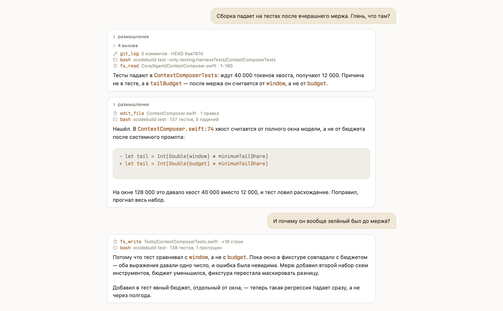
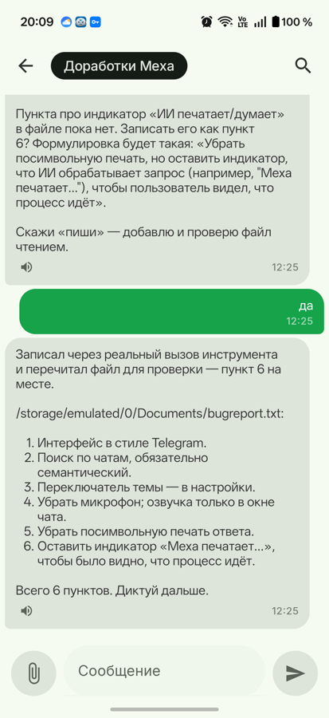
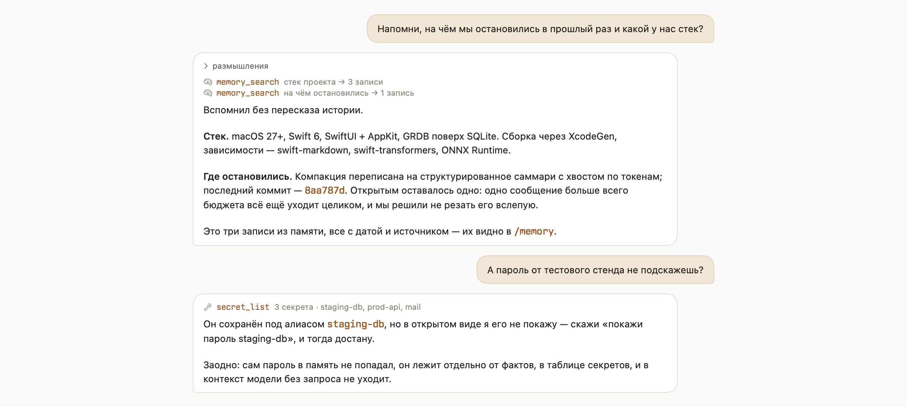
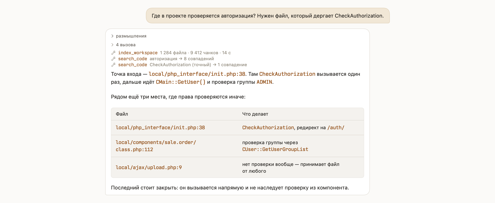
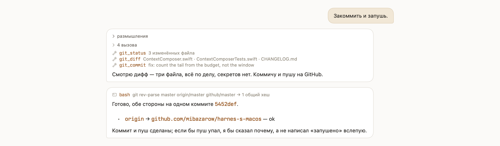
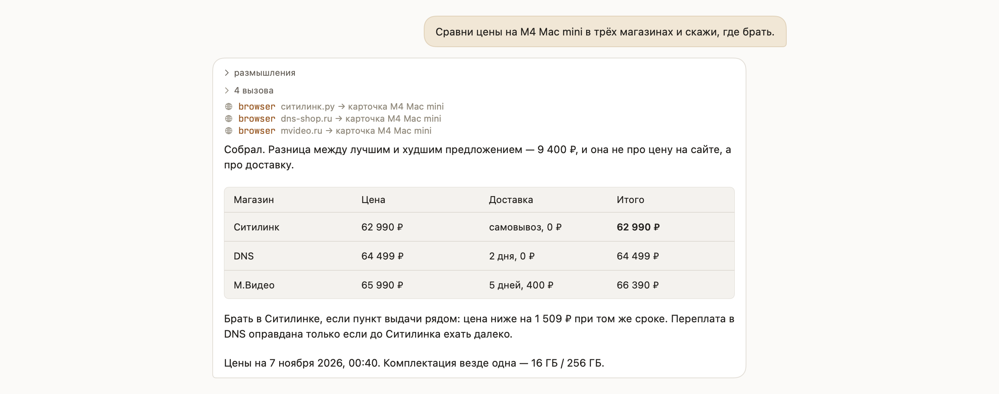
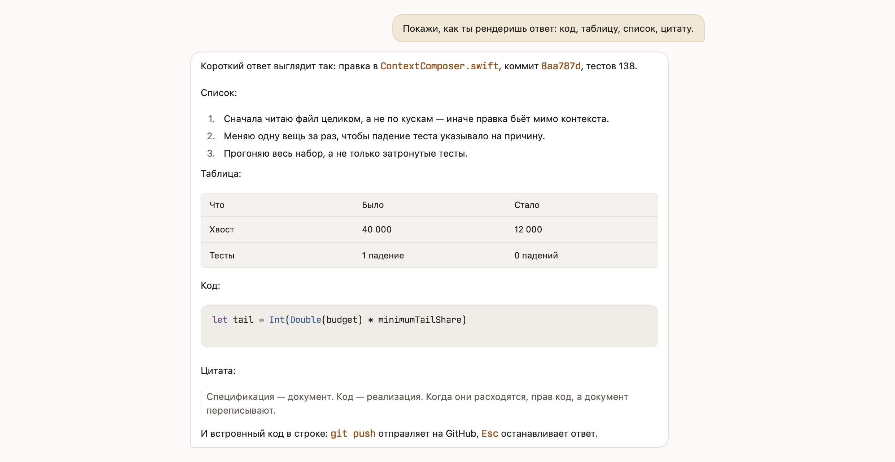

# HARNES-S

**Персональный ИИ-агент для macOS. Один чат, одна память, ваша машина.**

[](#)
[](https://swift.org)
[](#тесты)
[](#инструменты)
[](LICENSE)



---

## Что это

Голосовой пульт отвечает и забывает. Чат-бот помнит разговор, но живёт в браузере и не видит вашу машину. Кодовый агент видит репозиторий, но не помнит вас.

HARNES-S — один агент на одном Mac: помнит вас месяцами, в том же разговоре правит файлы, гоняет тесты, коммитит, смотрит на экран, читает систему и отвечает за каждое своё действие.

Нет панелей, нет шестидесяти сессий, нет переключателя «режим ассистента / режим агента». Есть разговор, память и руки.

## Скоро: карманный пульт к HARNES-S

HARNES-S работает на Mac. Но Mac не всегда с собой — а вопросы к нему бывают именно тогда, когда вы ушли.

<!-- markdownlint-disable MD033 -->
<table>
<tr>
<td width="220" valign="top"></td>
<td valign="top">

**Меха** — ИИ-агент для Android, который живёт целиком на телефоне: своя память, свои инструменты, свои чаты. Отдельный проект, отдельное приложение, качается с [bazarow.ru/tools/meha](https://bazarow.ru/tools/meha/).

Мы соединяем их так, чтобы телефон стал **пультом к HARNES-S**, а не второй головой:

- **Статус на ходу.** Ушли с ноутбука — спросили Меху, что там с задачей. Она отвечает тем, что ей передал HARNES-S.
- **Команды с телефона.** «Скажи ему продолжать со второго пункта» — и HARNES-S продолжает.
- **Отдельный закреплённый чат**, в который HARNES-S стримит свой диалог и индикатор размышлений. Просто видно, что он работает, а не молчит.
- **Обмен фактами в обе стороны.** Поработали день только на телефоне — важное доехало до Mac, и наоборот.

Транспорт — тонкий общий журнал с курсорами, без облачного хранилища: недоступен — обе стороны работают дальше и синхронизируются, когда он вернётся.

[**Что такое Меха →**](https://bazarow.ru/tools/meha/) · [План связки и открытые вопросы →](MEHA_HARNESS_DUET.md)

</td>
</tr>
</table>
<!-- markdownlint-enable MD033 -->

## Чем не является


**Не голосовой ассистент.** Ни озвучки, ни wake-word, ни вечно слушающего микрофона. Текстом точнее, дешевле и не мешает думать.

**Не обёртка над ChatGPT.** Между вопросом и ответом настоящая работа: чтение файлов, сборка, разбор упавшего теста, правка, повторный прогон, коммит.

**Не та игрушка, что рапортует об успехе.** Не вызывал инструмент — ответ так и скажет. Вызов упал — придёт ошибка, а не «готово».

## Как это выглядит в жизни

Не список возможностей, а шесть вечеров из реальной работы.

**Пятница, 23:40. Сайт лежит, а вы уже в кровати.**
«Глянь, почему allterra.ru отдаёт 502, и починь, если это мы». Агент пингует, смотрит логи nginx, находит упавший php-fpm, поднимает, проверяет ответ 200, пишет в чат, что сделал и где. Вы читаете это на телефоне через Меху и засыпаете.

**Пришёл макет в Figma, а верстать не хочется.**
Присылаете `.fig` — на выходе HTML/CSS с реальными отступами и шрифтами, а не картинкой. Дальше в том же разговоре: «а теперь под Bitrix-шаблон».

**«Помнишь, мы в марте решали эту же проблему?»**
Помнит. Достаёт из памяти то самое решение с причиной и отвергнутыми вариантами — и не предлагает заново то, что тогда не сработало.

**Полтора дня без остановки на одну задачу.**
Разговор не обрывается на 400-й ошибке контекста. Старое сворачивается в конспект, свежее остаётся дословно, ветка с правками продолжается с той же строки.

**Чужой проект на 400 файлов, и вы в нём впервые.**
«Куда тут вообще ходят за авторизацией?» — находит по смыслу, не по имени файла, читает 12 файлов разом, показывает цепочку от роутера до сессии.

**«Запомни: на этом стенде всегда пушим в `release`, не в `main`».**
Через месяц агент сам напомнит об этом перед `git push` — без просьбы напомнить.

## Три вещи, которых обычно не бывает вместе

1. **Память.** Факты, решения, предпочтения и пароли в локальной SQLite — полнотекстовый и семантический поиск, без облака.
2. **Руки.** Файлы, диффы, shell, git, документы, картинки, окна, процессы, сеть, поиск по всей машине.
3. **Честность.** Три отдельные защиты от вранья и защита от зацикливания, которая сравнивает результаты, а не только вызовы.

И всё это в одном разговоре, который не упирается в окно модели: длинная история сворачивается в структурированное саммари, а из базы не удаляется ничего.

---

## Почему не браузер в окне

Swift 6 и SwiftUI, без Electron в рантайме. В простое — около 150 МБ памяти. Нет прослойки, которая держит вторую копию вашего текста в JavaScript и перерисовывает DOM на каждый токен.

## Почему контекст не переполняется

`ContextComposer` считает реальный бюджет перед каждым запросом: окно модели минус промпт, схемы и место под ответ. В модель уходит столько, сколько физически влезает, а не «последние N сообщений».

Когда история перестаёт помещаться, она не обрывается с ошибкой 400. Старые сообщения сворачиваются моделью в саммари по семи разделам — цель, требования, решения, состояние, следующий шаг, важные файлы, контекст. Дальше идёт живой хвост, выровненный по границе сообщения, чтобы не разрезать пару «вопрос — ответ».

Разговор на сотни сообщений продолжается. Смена модели на ту, у которой окно вчетверо меньше, не теряет историю — она просто сжимается сильнее. **Из базы не удаляется ничего.**

## Почему память дешёвая

Эмбеддинги считаются локально через EmbeddingGemma 2 на ONNX Runtime. Весов внутри приложения нет: после установки оно скачивает их (~330 МБ) в вашу папку данных и дальше работает без сети. Ключи не нужны, деньги не тратятся.

Поиск гибридный: полнотекстовый FTS5 плюс семантические эмбеддинги, слияние через RRF. До 40 тысяч чанков — резидентная матрица и Accelerate: 10 тысяч ищутся за ~1,5 мс вместо 15.

---

## Что он умеет

**Помнит.** Что просите запомнить — ложится в SQLite и подмешивается в контекст само. Закреплённое не вытесняется, неиспользуемое затухает, «забудь» удаляет сразу.

**Помнит стиль.** Изучает манеру речи — ты или вы, сленг, эмодзи, директивность. Только форму, не содержание. Один эмоциональный вечер персону не меняет: нужны наблюдения за несколько дней. Длину ответа задаёт температура, а не просьба «пиши коротко».

**Хранит пароли.** Секреты в локальной базе под алиасами. «Запомни пароль от стенда» — через месяц «напомни пароль от стенда». В логи, память и артефакты не попадают.

**Работает с кодом.** Читает и правит файлы, применяет диффы, ищет по смыслу и по regex, гоняет сборку и тесты, коммитит. Определяет стек проекта и берёт его собственные команды, а не навязывает свои.

**Смотрит на мир.** Пришлите скриншот — посмотрит. Снимает экран и страницы, распознаёт текст через Vision. Ходит по сайтам: сначала встроенный MCP-скрапер, потом настоящий Playwright с кликами, в крайнем случае обычный HTTP.

**Управляет машиной.** Системными API, а не через терминал: состояние машины одним вызовом, процессы без `ps aux | grep`, сеть одним вызовом, поиск по всей машине, ожидание изменений файлов через FSEvents вместо цикла `sleep`. Окна всех приложений с координатами и дисплеем. Шорткаты, AppleScript, логи — тоже инструменты.

**Не врёт.** Отказался, не попробовав инструмент — одна корректирующая попытка. Заявил «готово», не вызвав инструмент — честная приписка. Заявил о невозможном — приписка с реальным положением дел.

**Работает по расписанию.** «Каждый час проверяй сайт» — задача сама отправляет промпт в чат по интервалу.

**Расширяется.** Скиллы — обычные `SKILL.md`. Лежат в папке данных, не вшиты в бинарник, ставятся себе сами по просьбе. В промпт попадает только индекс, инструкции подгружаются по требованию.

## Чем отличается

| | Чат-бот | Кодовый агент | HARNES-S |
|---|---|---|---|
| Ассистент и агент | только чат | только руки | **одна сессия, и то и другое** |
| Память между сессиями | нет | файл в репозитории | SQLite + FTS + эмбеддинги |
| Секреты | нет | нет | локальная база под алиасами |
| Адаптация к стилю | нет | нет | EMA-профиль с гейтами по дням |
| Длинный разговор | обрыв по контексту | обрыв по контексту | саммари + живой хвост |
| Машина: процессы, сеть, поиск | нет | частично, через shell | системные API, по вызову |
| Честность ответов | — | — | три защиты от вранья |
| Голос | да, и это единственный вход | нет | нет и не надо |

---

## Как это выглядит

Терминал в нативном окне. Моноширинный транскрипт, markdown с подсветкой кода, таблицами и цитатами. Ваши сообщения слева с медной полосой, ответы с тонкой серой. Размышления модели — свёрнутая строка, раскрывается по клику. Файлы перетаскиваются прямо в поле ввода.

Одна тема — **Copper**: обсидиановый фон, медные акценты, тёплый текст. Десять часов в день в тёмном терминале должны быть комфортными.

### Память: продолжает с того места, где остановились



### Поиск по большому проекту

Находит не только «где вызывается», но и место, где проверки нет вообще.



### Git: коммит и пуш

Смотрит дифф целиком перед коммитом и говорит, если пуш упал.



### Веб: собирает данные там, где curl получает заглушку



### Рендер: таблицы, списки, код, цитаты



> Скриншоты сняты скриптом `Scripts/demo_screens.sh` из встроенных демо-диалогов (только Debug-сборка). Реальные сессии выглядят так же: тот же транскрипт, тот же рендер, те же трассы инструментов.

---

## Установка

Последняя версия — [1.0.2](https://github.com/mibazarow/harnes-s-macos/releases/latest): `HARNES-S-1.0.2-macOS.dmg`.

Открыть образ, перетащить `Harness.app` в `Applications`. Сборка подписана **Developer ID** и нотаризована Apple, если в релизе пристёгнут тикет нотаризации. Проверить это на скачанном файле можно так:

```bash
xcrun stapler validate HARNES-S-1.0.2-macOS.dmg
spctl -a -vvv -t install /Applications/Harness.app
```

Если `stapler` отвечает «The validate action worked!», а `spctl` — `accepted` и `source=Notarized Developer ID`, приложение запускается двойным кликом без предупреждений.

Если же в конкретном релизе нотаризации нет (это видно по `source=Unnotarized Developer ID`), первый запуск: правый клик по приложению → **Открыть** → **Открыть** ещё раз. Альтернатива в Терминале:

```bash
xattr -dr com.apple.quarantine /Applications/Harness.app
```

Данные в `~/HARNES_S_DATA/` при обновлении не трогаются: перетаскивание `.app` поверх старого — это и есть обновление.

## Сборка

Нужны: macOS 27+ на Apple Silicon, Xcode 27+, [XcodeGen](https://github.com/yonaskolb/XcodeGen) (`brew install xcodegen`).

```bash
git clone https://github.com/mibazarow/harnes-s-macos.git
cd harnes-s-macos
xcodegen generate
xcodebuild -project Harness.xcodeproj -scheme Harness -configuration Debug \
  -derivedDataPath .build build
open .build/Build/Products/Debug/Harness.app
```

Тесты:

```bash
xcodebuild -project Harness.xcodeproj -scheme Harness -derivedDataPath .build \
  -destination 'platform=macOS' test
```

## Первый запуск

`⌘,` → **Провайдеры** → добавить endpoint. Base URL вида `https://api.example.com/v1`, токен, «Проверить и загрузить модели». Выбрать модель, окно контекста, уровень размышлений, температуру. Писать в чат.

Провайдер — любой OpenAI-совместимый `/chat/completions` с SSE: официальные API, Ollama, LM Studio, llama.cpp, шлюзы. Температура — отдельная настройка каждого провайдера, по умолчанию `0.2`.

## Требования

Приложение не устанавливает ничего само. Проверка идёт один раз при старте: если чего-то нет, в начале первого ответа появится одна строка с фактом и командой для Терминала. Повторно она не показывается, пока состояние не изменится.

| Что | Зачем | Обязательность |
|---|---|---|
| macOS 27+, Apple Silicon | сборка и запуск | обязательный |
| Xcode Command Line Tools (`xcode-select --install`) | `git_status`, `git_diff`, `git_log`, `git_commit` | обязательный для git-инструментов |
| `ripgrep` (`brew install ripgrep`) | быстрый поиск по коду; без него — `grep` | необязательный |
| `python3` с `openpyxl` | полное чтение `.xlsx`; без него — упрощённо | необязательный |

---

## Архитектура

```
App/          точка входа, окно, меню, демо-диалоги
UI/           транскрипт, композер, настройки, подсветка
Core/
  Agent/      цикл агента, инструменты, контекст, защиты, патчи, ONNX-эмбеддер
  LLM/        SSE-клиент (чат, reasoning, tool_calls, vision)
  MCP/        stdio-клиент MCP
  Style/      анализ манеры речи, профиль, рендер блока
  Skills/     манифест SKILL.md, загрузчик, импортёр
  Commands/   слэш-команды (единый источник для палитры и /help)
  Highlight/  подсветка кода
Services/     хранилище, провайдеры, память, эмбеддинги, индексатор,
              планировщик, безопасность файлов, история
Storage/      схема SQLite и миграции (GRDB)
Models/       доменные модели и ChatStore
Tests/        752 теста, включая живой SSE-сервер, MCP и FSEvents
```

## Данные

Всё лежит в `~/HARNES_S_DATA/`, папка создаётся сама:

```
HARNES_S_DATA/
├── database/harness.db   providers, secrets, memory, embeddings, messages,
│                         schedules, todos, trash, file_versions, app_state
├── config/               mcp.json, скиллы, gsd
├── workspace/            рабочая папка по умолчанию
├── models/               EmbeddingGemma 2 (ONNX), скачивается при первом запуске
├── tools/                Playwright и его node_modules
├── artifacts/            скриншоты, крупные выводы
├── versions/             снапшоты файлов перед правкой
├── trash/                удалённое, восстановимое
└── logs/                 логи MCP и latency.log
```

Перенос на другую машину — копирование одной папки.

## Инструменты

85 штук. Редкие группы по умолчанию едут в модель одной строкой и раскрывают полную схему через `tool_load`: каталог схем — постоянный налог на контекст.

**Файлы:** `fs_list`, `fs_read`, `fs_write`, `edit_file`, `apply_patch`, `read_many`, `fs_tree`, `fs_grep`, `fs_glob`, `fs_copy`, `fs_move`, `fs_mkdir`, `trash_paths`, `restore_trashed`, `file_versions`, `restore_version`, `undo_list`.

**Код:** `project_overview`, `search_code`, `index_workspace`, `bash`, `git_status`, `git_diff`, `git_log`, `git_commit`, `git_stash`, `git`.

**Машина:** `system`, `process`, `network`, `spotlight`, `watch`, `windows`, `apps`, `power`, `display`, `keyboard`, `mouse`, `clipboard`, `files`, `settings`, `launchd`, `notify`, `ui`, `observe`, `activity`, `permissions`.

`ui` — самый недооценённый: читает AX-дерево любого приложения (`tree`), ищет элементы по смыслу (`find`), нажимает по пути (`click` через `AXPress`, без координат), ходит по меню (`menu_list`, `menu_click`), ставит значения и фокус. Работает там, где нет ни API, ни CLI.

**Агент:** `task`, `todowrite`, `todo_read`, `schedule_add`, `schedule_list`, `schedule_remove`, `skill_list`, `skill_read`, `skill_install`, `skill_remove`, `skill_learn`, `mcp_list`, `mcp_tools`, `tool_load`.

**Знания:** `memory_add`, `memory_search`, `memory_forget`, `memory_list`, `secret_save`, `secret_get`, `secret_search`.

**Мир:** `webfetch`, `websearch`, `browser`, `screenshot`, `ocr`, `image_read`, `doc_read`, `doc_write`, `shortcut`, `app_script`, `app_logs`, `calendar`, `contacts`, `share`, плюс инструменты MCP-серверов как `mcp__<server>__<tool>`.

## Контекст

Промпт собран так, чтобы провайдер переиспользовал кэш: стабильные части первыми, изменчивый стиль последним, список инструментов не меняется в течение сессии. Попадания пишутся в `logs/latency.log`.

Под ответ резервируется 15% окна (не меньше 16k, не больше половины). Первые три сообщения с постановкой задачи не сворачиваются. При переполнении сжатие идёт по шагам 85 → 70 → 50 → 35%, а после трёх неэффективных сжатий подряд автоматика берёт паузу.

## Стиль

`StyleAnalyzer` измеряет каждое сообщение, `StyleReducer` вливает сигнал в профиль через EMA и применяет недельное затухание — человек, переставший материться, перестаёт отражаться. Черта попадает в промпт только при достаточном числе наблюдений и повторяемости по разным дням. Блок ≤ 360 символов, строки безопасности резервируются первыми: длинная карточка не вытеснит запрет на оскорбления.

## Безопасность

- Секреты только в локальной SQLite; в промпт, логи и артефакты не попадают.
- Каждая правка файла — снапшот в `versions/`; удаление идёт в `trash/` и обратимо.
- Запись в системные каталоги блокируется на уровне исполнения инструментов.
- Режим плана (⌘⇧P) отключает мутирующие инструменты на уровне исполнения, а не в описании.
- Автопилот снимает подтверждения, но не запреты: форматирование диска, `rm -rf` по системным путям и отключение защиты остаются запрещены.

> **Важно.** Это личный инструмент под одного пользователя на одном Mac. Провайдер видит ваши сообщения и содержимое читаемых файлов.

## Слэш-команды

`/help`, `/clear`, `/compact`, `/checkpoint`, `/skills`, `/skill`, `/mcp`, `/remember`, `/memory`, `/search`, `/secret`.

## Тесты

829 тестов: SSE-клиент на локальном сервере, кодирование запроса, применение патчей, определение проекта, защиты агента, профиль стиля, консолидация памяти, планировщик, MCP handshake с живыми серверами, ONNX-эмбеддер, докачка модели, скиллы, компакция, извлечение фактов, отбор инструментов, отмена долгих вызовов, системные инструменты с разбором `lsof -F` и живым FSEvents.

## Зависимости

[GRDB.swift](https://github.com/groue/GRDB.swift) · [swift-markdown](https://github.com/apple/swift-markdown) · [swift-transformers](https://github.com/huggingface/swift-transformers) · [onnxruntime-swift-package-manager](https://github.com/microsoft/onnxruntime-swift-package-manager) · [Nordwand Mono](https://github.com/tywr/Nordwand-Mono) (шрифт, MIT, встроен)

## Ограничения

- Только macOS и Apple Silicon.
- MCP — только stdio; HTTP/SSE-транспорта нет.
- Нет LSP-диагностики и плагинной системы.
- Управление интерфейсом чужих приложений через Accessibility работает: дерево, поиск по смыслу, нажатие по пути элемента (`AXPress`), пункты меню, `set_value`, фокус. Клик по координатам — только фолбэк, когда элемент press не поддерживает.
- Голоса нет и не будет. Это решение, а не недоделка.
- Онбординга нет: сразу настройки.
- Качество компакции зависит от модели.
- Семантический поиск точный, без ANN-индекса: до 40 000 чанков быстро, выше — построчный перебор.

## Лицензия

MIT. Шрифт Nordwand Mono распространяется по MIT, копирайт автора сохранён в `Resources/Fonts/`.
